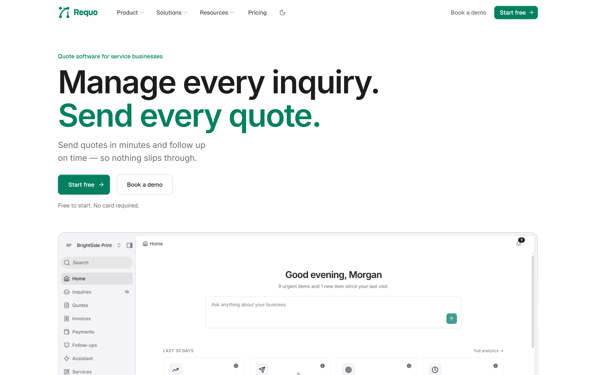
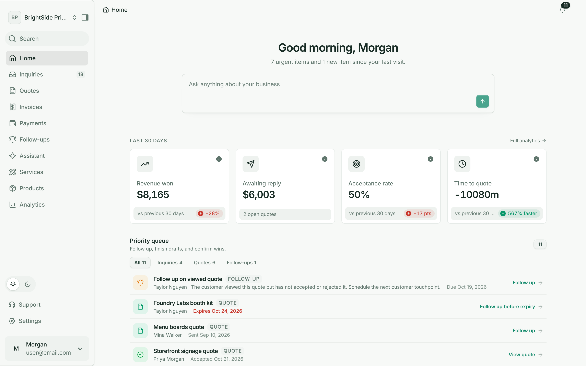
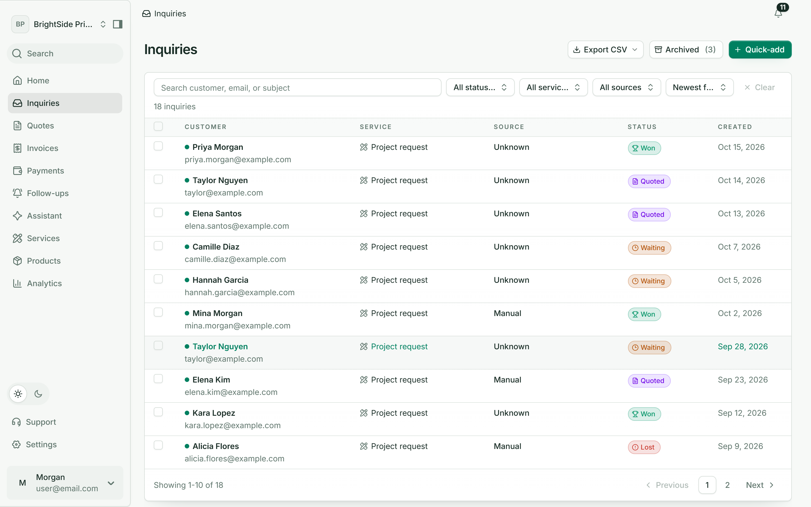
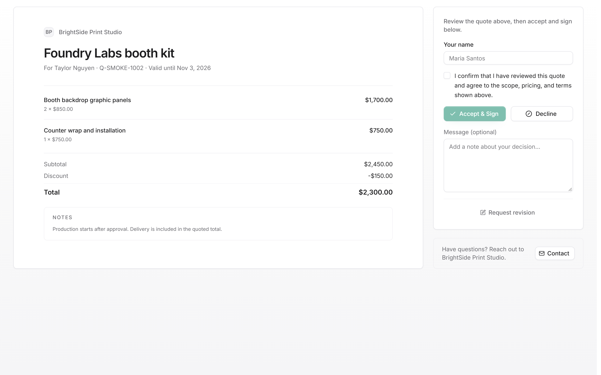

<p align="center">
  
</p>

<h1 align="center">Requo</h1>

<p align="center"><strong>Owner-led inquiry-to-quote-to-invoice software for service businesses.</strong></p>

<p align="center">Capture requests, send clear quotes, follow up consistently, and invoice accepted work — with AI assistance that never overrules the owner.</p>

<p align="center">
  
  
  
  
</p>

## Screenshots



| Business dashboard | Inquiries inbox |
| --- | --- |
|  |  |



Seeded demo data. Regenerate with `npm run screenshots` (needs the local database from [Local setup](docs/setup/local.md)).

## Who It's For

- **Business owners and operators** — qualify requests, prepare quotes, and see what needs action in one workspace.
- **Business members** — work inquiries, quotes, and invoices according to their assigned role.
- **Prospective customers** — submit inquiries and respond to shared quotes without needing a Requo account.

## How It Works

1. An owner creates a business during onboarding (guided starter templates), configures services and inquiry forms, and publishes public intake pages.
2. A customer submits an inquiry through a public form or chat — or the owner enters it manually. The owner reviews, qualifies, and prepares a quote from reusable products and quote-library data.
3. The quote is shared by public link or email. The customer views, accepts, rejects, or requests a revision; the owner follows up manually or with supported automated follow-up emails.
4. An accepted quote continues into an invoice. Money received outside Requo is recorded as a manual payment entry, and a record/receipt can be issued.
5. Analytics, notifications, audit history, members, and settings keep the workspace managed. Optional AI surfaces help customers qualify requests and help members work with business data.

## What Requo Does

- **Customer intake:** public business/service pages, configurable forms, manual inquiry creation, attachments, duplicate signals, qualification, and status tracking.
- **Quote work:** drafting and revisions, reusable product/quote library, version snapshots, public quote pages, customer responses (accept / reject / revision), and email templates.
- **Follow-up and visibility:** owner reminder tasks, supported automatic follow-up emails, conversion and workflow analytics, CSV exports, in-app notifications, web push, activity/audit records, and business membership.
- **Commercial continuation:** invoices from accepted quotes, manually recorded payments, quote acceptance records, approval flows, typed scope blocks, commercial schedules, and change orders.
- **Workspace management:** business onboarding templates, multiple businesses per account, role-aware membership, plan entitlements, and Polar subscriptions (Free, Pro, Business).

> **Agent vs Assistant:** the **Agent** is public customer-facing chat — its proposed inquiry needs customer confirmation before creation. The **Assistant** is the authenticated, business-scoped owner chat — it needs confirmation for customer-visible or pipeline-mutating work. AI drafts quote text grounded in business knowledge files, but **models never emit prices**: quote candidates return `unitPriceInCents: 0` and the server hydrates real prices from the database.

> **Manual payments only:** a payment record attests that the business received money *outside* Requo. Requo never processes money, charges cards, or provides a customer payment gateway. Records are voided, never edited or deleted.

## What Requo Is Not

No dispatch/job management, general calendar or crew scheduling, mobile app, marketplace, payroll, shared customer/CRM entity, payment processing, or general-purpose chatbot. Commercial schedules and approval workflows are quote/work-order concepts, not a calendar product.

## Stack

| Area | Implementation |
| --- | --- |
| Runtime | Node.js 22+, Next.js 16.3.5 App Router, React 19, TypeScript (strict) |
| UI | React Server Components by default, Tailwind CSS v4, shadcn/ui, Radix UI |
| Data | PostgreSQL, Drizzle ORM, `postgres-js`; committed SQL migrations under `drizzle/` |
| Identity | Better Auth (Drizzle adapter) — the only identity provider; every business query is `businessId`-scoped |
| Storage / realtime | Supabase private storage (via authenticated server routes) and realtime notification plumbing |
| Email | Resend, with Mailtrap then Brevo fallbacks |
| AI | Vercel AI SDK with a shared model router (Groq → Cerebras → Gemini → Mistral → Cloudflare → NVIDIA NIM → OpenRouter) |
| Background work | Inngest (local Dev Server) plus Vercel Cron route handlers |
| Billing | Polar subscriptions and checkout; role authorization stays separate from plan entitlement, enforced server-side |

## Quick Start

Prerequisites: Node.js 22+ and npm, plus either a cloud Supabase project or
Docker for the full-local stack. Copy `.env.example` to `.env.local` first.

### Cloud Supabase

```bash
cp .env.example .env.local   # fill in cloud Supabase + database values
npm install
npm run db:migrate           # first run, or after pulling new migrations
npm run dev                  # app on http://localhost:3000
```

### Full local (Docker)

```bash
cp .env.example .env.local   # set local database/Supabase values from `npx supabase status`
npx supabase start           # one-time: local Postgres, Storage, realtime (data persists)
npm run db:local:setup       # migrate + demo seed + local realtime setup
docker compose up --build    # app on http://localhost:3000, Inngest on http://localhost:8288
```

`npm run db:local:setup` resets application data and creates deterministic
local accounts and businesses — development only, and it refuses non-local
databases. It prints the account emails and password when it finishes; never
use those credentials outside a local environment. See
[Local setup](docs/setup/local.md) for every knob.

## Useful Commands

| Command | Purpose |
| --- | --- |
| `npm run dev` | Start the Next.js development server and Inngest Dev Server |
| `npm run dev:tunnel` | `npm run dev` plus an ngrok tunnel for inbound callbacks |
| `npm run dev:app` | Start only the Next.js development server |
| `npm run check` | Lint, typecheck, and repository audits |
| `npm run test` | Unit and component tests |
| `npm run test:integration` | Postgres-backed integration tests (migrates first) |
| `npm run test:e2e:smoke` | Playwright smoke journeys |
| `npm run build` | Production build |
| `npm run db:migrate` | Apply Drizzle migrations |
| `npm run db:local:setup` | Full-local: migrations + demo seed + realtime setup |
| `npm run db:seed` | Reset and seed local demo data (refuses non-local databases) |
| `npm run db:studio` | Open Drizzle Studio |

## Project Layout

```text
app/           Route groups (marketing, auth, business, public, checkout,
               onboarding), admin console, and API/webhook/cron handlers
features/      Product rules per domain (inquiries, quotes, invoices, …):
               actions, queries, mutations, schemas, components
lib/           Shared infrastructure: auth, database, AI router, billing,
               email, caching, providers
components/    ui/ primitives, shared/ compositions, shell/ navigation
emails/        Transactional email templates
scripts/       Migrations, seeders, audits, and operational tools
tests/         Unit, component, integration, and end-to-end tests
docs/          Setup, product, architecture, and domain documentation
```

`app/` stays thin (routing/rendering); product logic lives in `features/`; shared infrastructure lives in `lib/`. See [Development](docs/engineering/DEVELOPMENT.md) for the canonical patterns.

## Documentation

- [Documentation index](docs/README.md) — map to every guide; start here
- [Product requirements](docs/product/PRD.md) — what Requo currently provides
- [Technical reference](docs/architecture/TRD.md) — how it is implemented
- [Local setup](docs/setup/local.md) — environment variables and database options
- [Deployment](docs/operations/DEPLOYMENT.md) and [deployment setup](docs/setup/deployment.md)
- [Billing](docs/setup/billing.md) — Polar setup
- [Design system](DESIGN.md) — visual language and component standards
- [Domain language](CONTEXT.md) — payments, follow-ups, and acceptance terms
- [Testing](tests/README.md) — test tiers and fixtures
- [Contributing](CONTRIBUTING.md) — ground rules and verification
- [Security](SECURITY.md) — how to report vulnerabilities
- [Changelog](CHANGELOG.md) — notable changes

## License

AGPL-3.0-only, see [LICENSE](LICENSE). If you run a modified version as a network service, you must offer its source to users (AGPL section 13).
