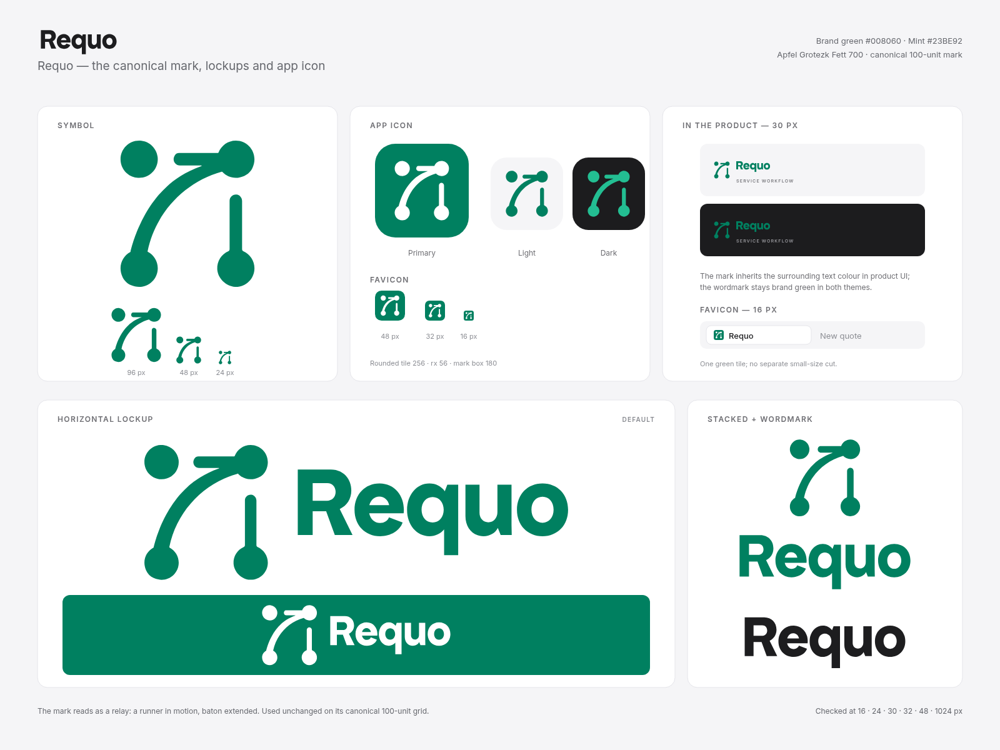

# Requo brand

**The relay mark.** A runner in motion, baton extended. The four dots and open
arc read as an opportunity moving through a handoff: the inquiry arrives, the
reply goes out, and the quote keeps moving. The off-axis terminal keeps the mark
from closing into a static network icon.

Requo is a quote workflow for service businesses. The identity stays just as
direct: one mark, one wordmark, brand green, and no gradients, effects or remote
assets.



## Files

| Path | Use |
| --- | --- |
| `svg/requo-symbol.svg` | Primary symbol, brand green `#008060`, 100-unit grid. |
| `svg/requo-symbol-currentColor.svg` | Same geometry with `fill="currentColor"` for UI code. |
| `svg/requo-symbol-black.svg` | One-colour ink symbol. |
| `svg/requo-symbol-white.svg` | Reversed symbol for green or night backgrounds. |
| `svg/requo-lockup-horizontal.svg` | Default horizontal lockup, brand green. |
| `svg/requo-lockup-horizontal-black.svg` | Horizontal lockup, ink. |
| `svg/requo-lockup-horizontal-white.svg` | Horizontal lockup, reversed. |
| `svg/requo-lockup-stacked.svg` | Stacked lockup, brand green. |
| `svg/requo-lockup-stacked-black.svg` | Stacked lockup, ink. |
| `svg/requo-lockup-stacked-white.svg` | Stacked lockup, reversed. |
| `svg/requo-wordmark.svg` | Outlined wordmark only, brand green, 720 × 300 canvas. |
| `svg/requo-wordmark-black.svg` | Outlined wordmark, ink. |
| `svg/requo-wordmark-white.svg` | Outlined wordmark, reversed. |
| `svg/requo-app-icon.svg` | Rounded green tile, white glyph. |
| `svg/requo-app-icon-light.svg` | Rounded mist tile, green glyph. |
| `svg/requo-app-icon-dark.svg` | Rounded night tile, mint glyph. |
| `svg/requo-app-icon-flat-*.svg` | Full-bleed square tiles for platform masks. |
| `svg/requo-app-icon-maskable-*.svg` | Full-bleed maskable icons with safe-zone padding. |
| `svg/requo-favicon.svg` | 32-unit green tile favicon. |
| `png/` | Raster exports at 16–1600 px; transparent where the artwork has padding, full-bleed for flat and maskable tiles. |
| `web/` | Favicon ICO/PNG/SVG, Apple touch icon, PWA icons and `site.webmanifest`. |

All SVG masters are filled outlines. There are no strokes, filters, embedded
rasters or external references in the masters, so they scale and print cleanly.

## Geometry

The mark is drawn on a **100 × 100** grid.

| Part | Value |
| --- | --- |
| Mark ink bounds | `x 8.79 … 91.20`, `y 5.00 … 95.00` — 82.41 × 90.00 |
| Origin dot | 22.91 diameter at `x=8.80 y=5.00` |
| Terminal post | 22.91 × 56.85 at `x=68.30 y=38.15` |
| Optical centre | `50, 50` |

The lockups place the existing mark on that grid:

| Asset | Canvas | Mark box | Wordmark em | Ink gap | Ink padding |
| --- | --- | --- | --- | --- | --- |
| Horizontal lockup | 300.4904 × 100 | 100 | 67.2 | 20 | 8.7912 |
| Stacked lockup | 198.0816 × 175.7024 | 90 | 67.2 | 20 | 8.7912 |
| Wordmark only | 720 × 300 | — | 246 | — | centred |
| App icon | 256 × 256 | 180 | — | — | rounded tile, `rx=56` |
| Maskable icon | 256 × 256 | 140 | — | — | full bleed |
| Favicon | 32 × 32 | 24 | — | — | rounded tile, `rx=7` |

“Ink gap” is measured between the mark’s ink and the wordmark’s ink. “Ink
padding” is the margin from the canvas edge to the nearest ink. The mark box is
the square that contains the mark and its built-in padding — 100 units at full
size, scaled to 90 units in the stacked lockup. Do not use the box edge as the
visual edge when measuring clear space.

Do not rebuild the mark from these measurements. The path data in
`public/logo.svg`, `app/icon.svg` and `lib/brand/glyph.ts` is canonical; the
numbers above are only for placing the packaged assets.

## Clear space and minimum sizes

- Keep clear space of at least **25% of the symbol height** on every side of the
  visible ink.
- Standard symbol: minimum **24 px** on screen, **8 mm** in print.
- Favicon / tile: minimum **16 px**.
- Horizontal lockup: minimum **180 px** wide.
- Stacked lockup: minimum **120 px** wide.
- App icon: **48 px** and above; use the favicon tile below that.

## Colour

| Token | Value | Use |
| --- | --- | --- |
| Brand green | `#008060` | Primary symbol, wordmark, app tile and web theme. |
| Mint | `#23BE92` | Glyph on the night tile; dark-surface accent. |
| Ink | `#1D1D1F` | One-colour print and type. |
| Paper | `#FFFFFF` | Reversed artwork and the glyph on the primary tile. |
| Mist | `#F5F5F7` | Light tile and preview surfaces. |
| Night | `#1C1C1E` | Dark tile and dark surfaces. |

In product UI the mark inherits `currentColor`; `BrandLogoIcon` is wrapped in
`text-primary`, so it resolves to brand green in both themes. The wordmark also
stays brand green. Do not introduce a second accent, tints, gradients or shadows
into the lockup.

## Typography

The wordmark is **Apfel Grotezk Fett 700**, outlined at **67.2 em** in the
lockups and **246 em** on the standalone canvas, with tracking of `-0.02em`. The
app UI uses Inter; marketing keeps its scoped Geist stack. The wordmark is
supplied as outlines, so no font file is required to use it.

Apfel Grotezk is licensed under the SIL Open Font License 1.1. The wordmark
outlines may be used as part of the Requo brand assets.

## Usage

Do:

- use the brand-green artwork on light surfaces, and white on green or night
  surfaces;
- keep the horizontal lockup as the default when there is room;
- use the symbol alone for compact UI, app icons and favicons;
- preserve the open arc, four dots and extended baton;
- keep the artwork proportional;
- give the mark a solid container when it sits on photography.

Do not:

- rotate, mirror, stretch, crop or re-space the mark;
- close the arc, add a fifth dot or shorten the terminal post;
- recolour the mark outside the palette;
- add gradients, strokes, shadows, outlines or effects;
- place the mark on a busy photo without a solid container;
- re-type the wordmark or set it in another typeface;
- place the green lockup on a mid-green or busy surface without checking
  contrast.

## Web implementation

`web/` contains the same mark as production-ready browser assets:

| File | Use |
| --- | --- |
| `favicon.ico` | 16, 32 and 48 px PNG favicons in one ICO. |
| `favicon.svg` | 32-unit scalable favicon. |
| `favicon-16.png`, `favicon-32.png`, `favicon-48.png` | PNG fallbacks. |
| `apple-touch-icon.png` | 180 px full-bleed green tile, no alpha. |
| `icon-192.png`, `icon-512.png` | PWA `any` icons. |
| `icon-maskable-512.png` | PWA maskable icon with safe-zone padding. |
| `site.webmanifest` | Name, colours and icon declarations. |

For another app, copy the contents of `web/` into its public directory and use:

```html
<link rel="icon" href="/favicon.ico" sizes="32x32" />
<link rel="icon" href="/favicon.svg" type="image/svg+xml" />
<link rel="apple-touch-icon" href="/apple-touch-icon.png" />
<link rel="manifest" href="/site.webmanifest" />
```

The manifest uses `Requo`, `standalone` display, `#008060` as the theme colour
and `#FFFFFF` as the background colour.

The live app still uses `app/icon.svg` and `/logo.svg` (declared in
`app/layout.tsx`). This pack is a source of masters and exports; adopting the
`web/` icons is a separate change to `app/layout.tsx` and `public/`.

## Verification

The mark has been checked at 16, 24, 30, 32, 48, 64, 96 and 128 px on light,
brand-green and night surfaces, and at 1024 px as a master export. The 30 px
product lockup was checked on mist and night sidebar surfaces. The favicon was
checked at 16, 32 and 48 px and inside the ICO container; app icons were checked
at 48, 96, 128, 192, 256, 512 and 1024 px. The horizontal lockup was checked at
180, 240, 320, 720 and 1600 px wide; the stacked lockup at 120, 160, 200, 300 and
1200 px wide.

The favicon uses a 24-unit mark box on a 32-unit tile rather than the full-size
symbol alone. At 16 px the tile keeps the four dots and the open arc legible
without changing the mark’s silhouette. No separate “small cut” is needed.

## Provenance

The mark’s path data predates this pack and is used unchanged; the packaged
variants only scale and recolour it. An earlier version of `public/logo.svg`
carried the embedded text “Created by mbok sumirna from Noun Project”; commit
`09cc4c0b` cropped that SVG to the current 100-unit viewBox and removed the
attribution text. This pack preserves the geometry but does not establish a
licence or ownership.

Before a public launch, confirm the applicable Noun Project licence (attribution
or a paid royalty-free licence), complete trademark clearance, and proof the
brand green for print. Those clearances remain the project’s responsibility.
