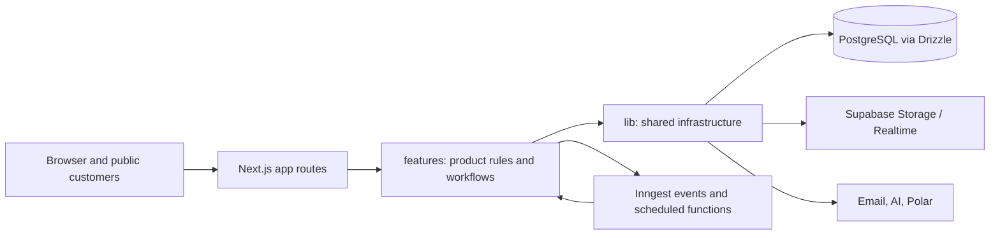

# Requo Technical Reference

**Status:** Current implementation reference, verified against the working
tree on 2026-10-12. See the [PRD](../product/PRD.md) for product intent.
This document summarizes architecture; source, migrations, configuration, and
tests define exact behavior.

## Stack

| Area | Current implementation | Evidence |
|---|---|---|
| Runtime/framework | Node.js 22+, Next.js 16.3.5 App Router, React 19.2.4, TypeScript 5.9.3 | [`package.json`](../../package.json), [`.nvmrc`](../../.nvmrc), [`next.config.ts`](../../next.config.ts) |
| UI | React Server Components by default, client components where interaction requires them; Tailwind CSS 4.2.2, Radix primitives and repository-owned components | [`app/`](../../app/), [`components/`](../../components/), [`DESIGN.md`](../../DESIGN.md) |
| Data | PostgreSQL, Drizzle ORM 0.45.2, postgres-js; SQL migrations are committed under `drizzle/` | [`lib/db/client.ts`](../../lib/db/client.ts), [`lib/db/schema/`](../../lib/db/schema/), [`drizzle/`](../../drizzle/), [`drizzle.config.ts`](../../drizzle.config.ts) |
| Identity | Better Auth 1.7.4 with the Drizzle adapter | [`lib/auth/`](../../lib/auth/), [`auth route`](../../app/api/auth/%5B...all%5D/route.ts) |
| Async work | Inngest 4.4.0, exposed through `/api/inngest`; Vercel Cron invokes selected route handlers | [`lib/inngest/`](../../lib/inngest/), [`Inngest route`](../../app/api/inngest/route.ts), [`vercel.json`](../../vercel.json) |
| Storage/realtime | Supabase Storage and authenticated Realtime notification plumbing; Postgres application data uses Drizzle | [`lib/supabase/`](../../lib/supabase/), [`lib/db/`](../../lib/db/) |
| Billing/email/AI | Polar, provider-fallback transactional email, Vercel AI SDK 6.0.276 with a shared model router | [`lib/billing/`](../../lib/billing/), [`lib/email/`](../../lib/email/), [`lib/ai/`](../../lib/ai/) |
| Tests | Vitest, Testing Library, PostgreSQL integration tests, Playwright | [`Vitest config`](../../vitest.config.ts), [`Playwright config`](../../playwright.config.ts), [`tests/`](../../tests/) |

The lockfile is `package-lock.json`; the repository is a single application,
not a workspace monorepo. Do not infer installed APIs from a different
framework version. See [Next.js documentation lookup](#framework-documentation).

## System boundaries

`app/` is the transport and rendering layer: route groups separate marketing,
authentication, business workspaces, public pages, checkout, and administration.
Route handlers expose APIs, webhooks, cron endpoints, and Inngest. Product
queries, validation, actions, and mutations live primarily in `features/`.
Provider clients, database access, auth, caching, and shared policies live in
`lib/`. `components/` contains shared UI primitives, compositions, providers,
and shell/navigation; `emails/templates/` owns transactional email content.

The boundary is a convention supported by the current module layout, not a
separate package-enforced architecture. Follow established feature ownership
and inspect imports before moving behavior.

## Request and rendering model

The App Router serves server-rendered pages and route handlers. Pages and
layouts are generally server components; interactive forms, chat, optimistic
lists, and browser integrations cross into client components. Dashboard routes
use `instant` static shells and put dynamic reads below `<Suspense>` so route
structure can paint while business data streams. The detailed invariants and
exceptions are in [Instant Navigation](instant-navigation.md), `next.config.ts`,
[`lib/instant-navigation/`](../../lib/instant-navigation/), and route-level
tests.

[`proxy.ts`](../../proxy.ts) handles route-level response behavior, business slug cookies, public
Markdown content negotiation, and an early optimistic `/admin` role gate. The
admin gate is not the authorization boundary by itself: server-side admin
helpers re-check access for pages, actions, queries, and mutations. Private
business routes also receive noindex and private cache headers. Next.js route
handlers and server actions delegate business rules to feature modules.

## Product and data flow

Public inquiry submissions, owner-created inquiries, and the visitor-approved
Agent proposal converge on `createInquirySubmission()` in
[`features/inquiries/mutations.ts`](../../features/inquiries/mutations.ts). That transaction creates the inquiry and
related activity/attachment rows; follow-on qualification, notifications,
email, audit, push, and event work use the relevant feature/integration
boundaries.

Quotes are business-scoped records with line items and version snapshots. The
schema is maintained under [`lib/db/schema/`](../../lib/db/schema/) and
feature behavior under [`features/quotes/`](../../features/quotes/).
Sending creates a public token and may send email; public quote responses
record acceptance/rejection/revision. Accepted quotes can continue to
invoicing. Sent invoices snapshot customer-facing values. Payment entries are
manually recorded and voided rather than edited/deleted; non-void entries
determine invoice balances. See [`features/`](../../features/), the schema
modules, and integration tests for exact lifecycle transitions.

## Persistence and migrations

`lib/db/client.ts` constructs a typed Drizzle client over postgres-js using
`DATABASE_URL`. Schemas are grouped by domain under `lib/db/schema/` and
re-exported through `index.ts`. `drizzle/` contains sequential SQL migrations
and the Drizzle journal. Edit schema sources and generate a new migration;
never rewrite an applied migration. `npm run vercel-build` runs strict
migrations before the Next.js build and requires `DATABASE_MIGRATION_URL`.
The complete workflow and direct-connection constraint are in
[Database Migrations](../database-migrations.md).

Supabase is not the application ORM or auth system. It is used for private file
storage and Realtime notification delivery. Private assets are downloaded
through authenticated server routes. Storage policy/bucket changes are
migration-owned; service-role credentials stay server-side.

## Identity, authorization, and tenant isolation

Better Auth is the only identity/session provider. It uses the Drizzle/Postgres
adapter and is mounted at
[`/api/auth/[...all]`](../../app/api/auth/%5B...all%5D/route.ts); signup/profile creation,
onboarding, and business membership have separate feature flows. Supabase Auth
is not used.

Business context helpers resolve the signed-in user and membership, then
business data access is scoped by `businessId`. Use `getBusinessActionContext()`
and existing business-scoped query/mutation helpers in
[`lib/db/business-access.ts`](../../lib/db/business-access.ts); never trust a
client or model-supplied business ID. Admin routes are rejected by the proxy
before rendering when its session-derived predicate denies access, and admin
pages/actions/queries also call the server guard. That predicate has a
session-role fast path: Better Auth's cookie cache can retain an old role or
ban state for up to 300 seconds, and an `admin` role from that cached session
is not re-read from the database on the fast path. This is a bounded
consistency risk, not a DB-authoritative role check. See
[`features/admin/access.ts`](../../features/admin/access.ts),
[`lib/auth/admin-identity.ts`](../../lib/auth/admin-identity.ts), and
[`proxy.ts`](../../proxy.ts). Public tokens and Agent session tokens are
separate capabilities with narrower scopes. Detailed invariants are in the
[Security guide](../security/SECURITY.md), `lib/auth/`, and
`lib/db/business-access.ts`.

## APIs, integrations, and asynchronous work

Route handlers cover Better Auth, AI chat, business/public APIs, file access,
Polar checkout/webhooks, push subscription/realtime tokens, exports, Inngest,
and selected cron endpoints. `lib/email/` implements transactional provider
fallback (Resend, Mailtrap, Brevo); `lib/billing/` owns Polar mapping,
subscription writes, webhook idempotency, and plan resolution. Subscriptions
are business-scoped; `business_subscriptions` is authoritative and
`businesses.plan` is a denormalized cache.

[`app/api/inngest/route.ts`](../../app/api/inngest/route.ts) registers event and
cron functions from [`lib/inngest/functions/`](../../lib/inngest/functions/).
These drive qualification, knowledge-file processing,
reminders, report delivery, follow-ups, expiry, and maintenance work. Selected
Additional scheduled tasks are exposed as Vercel Cron routes in
[`vercel.json`](../../vercel.json); do not
assume every scheduled job uses the same scheduler. Check registrations and
provider dashboards for operational state.

## AI and model integrations

There are two chat products: the anonymous customer-facing Agent in
`features/ai-agent/` and the authenticated owner Assistant in
`features/owner-assistant/`. Their API routes are under `app/api/ai/`. AI quote
drafting and business-knowledge retrieval are separate feature flows. Model
selection, provider SDKs, fallback, usage limits, caching, input sanitization,
output filtering, and invocation logging are centralized in `lib/ai/`.

Providers currently wired through the router include Groq, Cerebras, Gemini,
Mistral, Cloudflare Workers AI, NVIDIA NIM, and OpenRouter. Agent tools stage an
inquiry proposal; only visitor approval creates it. Agent sessions are not
searchable by the business; transcripts become visible only through an
inquiry they produced, and abandoned transcripts have bounded retention.
Assistant reads and writes are business-scoped; outbound or pipeline-mutating
tools require explicit confirmation. Model-generated prices are not trusted:
quote prices are hydrated from database-backed candidates. Preserve these
boundaries when changing prompts, tools, providers, or persistence. See
[`lib/ai/`](../../lib/ai/), both feature directories, and their integration
tests.

The customer-facing **Agent** and authenticated owner **Assistant** are
separate products and data scopes. An Agent session is visible to a business
only through an inquiry it produced; abandoned sessions have bounded
retention. Assistant history is scoped to its owner and business. Model
selection reserves estimated provider token capacity, turns have bounded
context and tool steps, and retry behavior must not duplicate side effects.
These constraints are implemented across `features/ai-agent/`,
`features/owner-assistant/`, and `lib/ai/`; their tests are the executable
contract.

## Identifiers and transaction invariants

New Requo-owned entity IDs are generated app-side as UUIDv7 by
[`lib/ids.ts`](../../lib/ids.ts); existing text IDs remain unchanged.
Customer-visible quote, invoice, and payment numbers are separate from
internal IDs. Payment numbers are allocated per business and year using the
transactional counter in `business_payment_counters`; payment form retries
use a per-business idempotency key. Payment entries are manual records and
are voided rather than edited or deleted. See
[`lib/db/schema/`](../../lib/db/schema/),
[`features/invoices/`](../../features/invoices/), and related integration
tests for exact behavior.

## Caching, client state, and observability

Server data uses Next.js Cache Components and tagged invalidation for business,
membership, and billing views; consult `lib/cache/` and mutation call sites
before changing invalidation. Upstash Redis is optional for selected AI cache,
deduplication, capacity, and rate-limit paths; those modules have in-process
fallbacks. It is not the primary application database. Client state is local
to feature needs; there is no general global state store. The owner Assistant
has a tab-local live chat store.

Errors are handled at route/feature boundaries and streamed UI boundaries.
The root layout wires Vercel Analytics and Speed Insights; server-side
diagnostics use console logs plus persisted AI invocation/security and
audit/activity records. A general distributed tracing system is not evident
in the repository. Provider dashboards remain authoritative for external
quota and health.

## Configuration, development, and deployment

[`lib/env.ts`](../../lib/env.ts) validates runtime environment names and optional provider
configuration. `.env.example` is the safe name/reference list; never copy
environment values into documentation. Local development can use Docker
Postgres (`docker-compose.yml`) or the documented Supabase setup. Vercel is
configured for production branch deployment in `vercel.json`; the build
command applies strict migrations before `next build`. See
[Development](../engineering/DEVELOPMENT.md) and
[Deployment](../operations/DEPLOYMENT.md).

## Framework documentation

Before changing Next.js code, resolve the installed `next` package from the
workspace containing the code, then read the relevant guide under its
`dist/docs/` directory. In this repository that is currently
`node_modules/next/dist/docs/`. The generator at
`node_modules/next/dist/server/lib/generate-agent-files.js` owns the managed
agent block. Check version-matched docs and deprecations before using public
online docs; this app currently pins Next.js 16.3.5.

## Tests and CI

Unit and component tests use Vitest; database-backed behavior uses a separate
Vitest integration configuration; Playwright covers browser journeys. The
GitHub Actions workflow currently runs `npm ci`, `npm run check`, `npm run
test`, and `npm run build`; local integration and browser smoke commands exist
but are not run by that workflow. See [`tests/README.md`](../../tests/README.md)
and [Development](../engineering/DEVELOPMENT.md).

## Known constraints

- Payment entries are attestations of money received elsewhere; no gateway,
  online payment page, or refund processing is implemented.
- Customer identity remains denormalized on commercial records; there is no
  customer master/CRM entity.
- There are two historical migrations with the `0021` prefix. Journal order
  governs application; do not rename committed migrations. See
  [`technical-debt.md`](../technical-debt.md).
- Product scope blocks, approvals, commercial schedules, and change orders
  are implemented in the current schema/features; their detailed product
  semantics continue to evolve and should be verified in code/tests.
