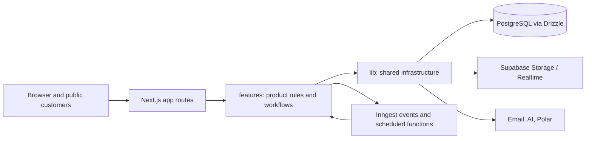

# Requo Technical Reference

**Status:** Current implementation reference, verified against the working
tree on 2026-10-12. See the [PRD](../product/PRD.md) for product intent.
This document summarizes architecture; source, migrations, configuration, and
tests define exact behavior.

## Stack

| Area | Current implementation | Evidence |
|---|---|---|
| Runtime/framework | Node.js 24+, Next.js 16.3.8 App Router, React 19.2.4, TypeScript 5.9.3 | [`package.json`](../../package.json), [`.nvmrc`](../../.nvmrc), [`next.config.ts`](../../next.config.ts) |
| UI | React Server Components by default, client components where interaction requires them; Tailwind CSS 4.2.2, Radix primitives and repository-owned components | [`app/`](../../app/), [`components/`](../../components/), [`DESIGN.md`](../../DESIGN.md) |
| Data | PostgreSQL, Drizzle ORM 0.45.2, postgres-js; SQL migrations are committed under `drizzle/` | [`lib/db/client.ts`](../../lib/db/client.ts), [`lib/db/schema/`](../../lib/db/schema/), [`drizzle/`](../../drizzle/), [`drizzle.config.ts`](../../drizzle.config.ts) |
| Identity | Better Auth 1.7.4 with the Drizzle adapter | [`lib/auth/`](../../lib/auth/), [`auth route`](../../app/api/auth/%5B...all%5D/route.ts) |
| Async work | Inngest 4.4.0, exposed through `/api/inngest`; Vercel Cron invokes selected route handlers | [`lib/inngest/`](../../lib/inngest/), [`Inngest route`](../../app/api/inngest/route.ts), [`vercel.json`](../../vercel.json) |
| Storage/realtime | Supabase Storage and authenticated Realtime notification plumbing; Postgres application data uses Drizzle | [`lib/supabase/`](../../lib/supabase/), [`lib/db/`](../../lib/db/) |
| Billing/email/AI | Polar, provider-fallback transactional email, Vercel AI SDK 6.0.276 with a shared model router | [`lib/billing/`](../../lib/billing/), [`lib/email/`](../../lib/email/), [`lib/ai/`](../../lib/ai/) |
| Tests | Vitest, Testing Library, PostgreSQL integration tests, Playwright | [`Vitest config`](../../vitest.config.ts), [`Playwright config`](../../playwright.config.ts), [`tests/`](../../tests/) |

The lockfile is `package-lock.json`; the repository is a single application,
not a workspace monorepo. Do not infer installed APIs from a different
framework version. See [Next.js documentation lookup](#framework-documentation).

## System boundaries

`app/` is the transport and rendering layer: route groups separate marketing,
authentication, business dashboards, public pages, checkout, and administration.
Route handlers expose APIs, webhooks, cron endpoints, and Inngest. Product
queries, validation, actions, and mutations live primarily in `features/`.
Provider clients, database access, auth, caching, and shared policies live in
`lib/`. `components/` contains shared UI primitives, compositions, providers,
and shell/navigation; `emails/templates/` owns transactional email content.

The boundary is enforced by
[`scripts/audit-feature-boundaries.ts`](../../scripts/audit-feature-boundaries.ts)
(`npm run audit:feature-boundaries`, part of `npm run check`), not only by
convention:

- `app/` may import `features/`, `lib/`, and `components/`; the reverse imports
  are rejected.
- `lib/` must not import `features/` at runtime. `lib/inngest/functions/` is
  the async composition root because it registers feature jobs; other reviewed
  exceptions are listed in the audit.
- `components/` outside the composition layers stays feature-agnostic; existing
  reviewed exceptions are listed in the audit. `components/shell/`,
  `components/providers/`, and `components/marketing/` compose product surfaces
  and may import features.
- A feature's public entry points are its root-level modules
  (`features/<domain>/*.ts[x]`) and its `components/` tree. Nested folders such
  as `jobs/`, `tools/`, `prompts/`, and other helpers are private, so a
  cross-feature import cannot reach an internal module.

UI access to database internals is enforced separately by
[`scripts/audit-tenant-boundary.ts`](../../scripts/audit-tenant-boundary.ts).
Follow established feature ownership and inspect imports before moving
behavior; these are lightweight module rules, not separate packages.

## Request and rendering model

The App Router serves server-rendered pages and route handlers. Pages and
layouts are generally server components; interactive forms, chat, optimistic
lists, and browser integrations cross into client components. Dashboard routes
use `instant` static shells and put dynamic reads below `<Suspense>` so route
structure can paint while business data streams. The detailed invariants and
exceptions are in [Instant Navigation](instant-navigation.md), `next.config.ts`,
[`lib/instant-navigation/`](../../lib/instant-navigation/), and route-level
tests.

[`proxy.ts`](../../proxy.ts) handles route-level response behavior, business slug cookies, public
Markdown content negotiation, and an early optimistic `/admin` role gate. The
admin gate is not the authorization boundary by itself: server-side admin
helpers re-check access for pages, actions, queries, and mutations. Private
business routes also receive noindex and private cache headers. Next.js route
handlers and server actions delegate business rules to feature modules.

## Product and data flow

Public inquiry submissions, owner-created inquiries, and the visitor-approved
Agent proposal converge on `createInquirySubmission()` in
[`features/inquiries/mutations.ts`](../../features/inquiries/mutations.ts). That transaction creates the inquiry and
related activity/attachment rows; follow-on qualification, notifications,
email, audit, push, and event work use the relevant feature/integration
boundaries.

Inquiry attachments upload directly to private storage using a signed token.
Before creating the inquiry, the server verifies the stored size against the
plan limit and detects the MIME type from downloaded bytes, requiring a match
with the signed filename's allowed type. Storage MIME metadata is untrusted.

Quotes are business-scoped records with line items and version snapshots. The
schema is maintained under [`lib/db/schema/`](../../lib/db/schema/) and
feature behavior under [`features/quotes/`](../../features/quotes/).
Sending creates a public token and may send email; public quote responses
record acceptance/rejection/revision. Accepted quotes can continue to
invoicing. Sent invoices snapshot customer-facing values. Payment entries are
manually recorded and voided rather than edited/deleted; non-void entries
determine invoice balances. See [`features/`](../../features/), the schema
modules, and integration tests for exact lifecycle transitions.

A quote-linked invoice keeps the quote's line items and totals: the server
discards the submitted ones, so only the customer-facing fields and the date
order are validated for it. The invoice status a filter matches is the derived
effective status, not the stored lifecycle value, and the SQL expression and
the TypeScript derivation are kept in lockstep so no filter option can be a
permanent no-op. Voiding an invoice or a payment requires a reason, and a bulk
void re-checks recorded payments under the same row lock the payment path
uses, so a payment can never be stranded on a voided invoice. Requo-delivered
quote and invoice emails share one allowance, and both send paths record the
delivery method so the counter sees them.

The server owns quote money. The editor submits the owner's raw discount and
tax intent (value plus amount/percentage) and the server derives the amounts
from the submitted line items; the persisted absolute amounts are re-read as
amounts, never as percentages. The send gates — required scope blocks, intake
readiness, a schedule that no longer matches the total, and a validity date
that has passed — are evaluated before any customer-facing delivery, and a
quote with a zero-priced line item is refused when sending. A public response
is a conditional transition on a locked row, so an acceptance record and the
quote status can never disagree. Public tokens are bearer capabilities: they
are validated for scope, expiry, business, and record state on every use, and
the rate-limit ledger stores a hash of the token rather than the token.

Business analytics aggregations live in
[`features/analytics/queries.ts`](../../features/analytics/queries.ts). Each
tab has one cached aggregator (`getOverviewData`, `getPerformanceData`,
`getOperationsData`, `getTeamData`) that combines live tables with
`analytics_daily_rollups`; rollups cover complete past days and the current day
is read live. When a window contains days the rollup job has not processed
(yet), the series builder fills those days from the live source tables, so a
trend chart never reads as a flat zero line for a business whose history
predates the job. The live fallback and the rollup count the same things —
visitors who opened a service form, form views with a form, live inquiries
and quotes — so a window that mixes rolled-up and live days plots one
definition. A definition change is applied to the days already rolled up with
`npm run db:backfill-rollups -- --from=YYYY-MM-DD --to=YYYY-MM-DD`.

Every metric states the population it counts. "Revenue won" and "Avg won
deal" count the quotes accepted inside the period, while the quote-outcome
split counts the quotes sent inside the period and the response each one
received. "First response" averages the inquiries that got a team reply and
reports how many of the period's inquiries that was, because an average over
answered inquiries alone improves as the service gets worse. Preset ranges
use `"use cache"` with `hotBusinessCacheLife` and business/tab tags, while
custom ranges compute directly. Plan access is checked server-side before a
tab's aggregator runs, and the export route re-resolves the window so plan
caps cannot be bypassed. Goals, annotations, and scheduled reports are
business-scoped records managed through `app/api/business/[slug]/analytics/*`.

## Persistence and migrations

`lib/db/client.ts` constructs a typed Drizzle client over postgres-js using
`DATABASE_URL`. Schemas are grouped by domain under `lib/db/schema/` and
re-exported through `index.ts`. `drizzle/` contains sequential SQL migrations
and the Drizzle journal. Edit schema sources and generate a new migration;
never rewrite an applied migration. `npm run vercel-build` runs strict
migrations before the Next.js build and requires `DATABASE_MIGRATION_URL`.
Because the previous deployment keeps serving while that build runs, schema
changes must stay backward-compatible with the deployed code and destructive
changes are deferred to a later release.
The complete workflow and direct-connection constraint are in
[Database Migrations](../database-migrations.md).

Supabase is not the application ORM or auth system. It is used for private file
storage and Realtime notification delivery. Private assets are downloaded
through authenticated server routes. Storage policy/bucket changes are
migration-owned; service-role credentials stay server-side.

### Customer identity

There is no customer master entity. `inquiries`, `quotes`, and `invoices` each
store their own customer snapshot: name, optional email, contact method, and
contact handle (see [`lib/db/schema/`](../../lib/db/schema/)). Creating a quote
or invoice carries the current values forward; sending records the values shown
to the customer. Editing one record therefore never rewrites another record or
an already-issued document.

The invoice list uses `(business_id, customer_email)` as a filtering index. The
[customer-history query](../../features/customer-history/queries.ts) and
reporting paths normalize email and contact handles at read time to match
related records within a business, but that matching does not persist an
identity or write values back to the source records. Email is optional, so it
cannot serve as an identity key by itself. This is deliberate:

- Public inquiry and quote journeys require no customer account.
- A sent quote or invoice preserves exactly what the customer saw.
- Tenant isolation does not depend on a cross-business identity graph.

Introduce a business-scoped customer entity only when at least one of these is a
real product requirement:

- Owners need durable cross-inquiry history, shared notes, or preferences for a
  customer rather than per-record detail.
- Duplicate detection or merge across email/phone variants is required, not
  just search.
- A contact change must propagate to open records while issued documents keep
  their historical snapshot.
- Customer-level reporting or segmentation cannot be derived from the existing
  records.

If those conditions arrive, use the expand/contract sequence from
[Database Migrations](../database-migrations.md): add `customers` and a nullable
`customer_id`, backfill within each business using a normalized contact key,
dual-write during the transition, switch reads, and only then remove redundant
columns. Plan for merge semantics, deletion, cache invalidation, and document
snapshots before writing the migration; do not key the entity on email alone.
Until then, customer fields on commercial records are snapshots, not identity.

## Identity, authorization, and tenant isolation

Better Auth is the only identity/session provider. It uses the Drizzle/Postgres
adapter and is mounted at
[`/api/auth/[...all]`](../../app/api/auth/%5B...all%5D/route.ts); signup/profile creation,
onboarding, and business membership have separate feature flows. Supabase Auth
is not used.

Business context helpers resolve the signed-in user and membership, then
business data access is scoped by `businessId`. Use `getBusinessActionContext()`
and existing business-scoped query/mutation helpers in
[`lib/db/business-access.ts`](../../lib/db/business-access.ts); never trust a
client or model-supplied business ID. Admin routes are rejected by the proxy
before rendering when its session-derived predicate denies access, and admin
pages/actions/queries also call the server guard. That guard is
database-authoritative: it always re-reads `user.role` and `user.banned` and
grants only on `role = "admin"`, so a demotion or ban is enforced on the next
admin request even though Better Auth's cookie cache can show the old role to
the proxy for up to 300 seconds. `ADMIN_EMAILS` is a bootstrap input and a hint
for the proxy gate, not a runtime grant. Demotion, suspension, session
revocation, and account deletion remove the target's own sessions and any
impersonation sessions they started. Revoking an impersonation session also
expires Better Auth's session cookies, because its signed cookie cache can
otherwise keep the deleted session usable until the payload lapses. See
[`features/admin/access.ts`](../../features/admin/access.ts),
[`lib/auth/admin-identity.ts`](../../lib/auth/admin-identity.ts), and
[`proxy.ts`](../../proxy.ts). Public tokens and Agent session tokens are
separate capabilities with narrower scopes. Detailed invariants are in the
[Security guide](../security/SECURITY.md), `lib/auth/`, and
`lib/db/business-access.ts`.

Application-level predicates are the tenant boundary today. Drizzle connects
as the `postgres` table-owner role, which bypasses the default-deny RLS
policies in [`drizzle/0007_enable_rls_all_tables.sql`](../../drizzle/0007_enable_rls_all_tables.sql);
those policies only constrain Supabase `anon`/`authenticated` traffic. The
approved pattern is a verified context from `getBusinessActionContext()` (or a
request/public-token context helper) followed by `*ForBusiness` queries and
mutations. Every `UPDATE` and `DELETE` repeats `businessId` in its predicate,
including writes that follow a scoped read, and background jobs re-check the
`businessId` carried in their event payload. Cross-tenant integration tests
cover reads, exports, writes, files, analytics, and Assistant tools;
[`scripts/audit-tenant-boundary.ts`](../../scripts/audit-tenant-boundary.ts)
blocks new DB access from components, pages, and unapproved server actions.
Database-enforced isolation would require a dedicated non-owner application
role, `FORCE ROW LEVEL SECURITY`, policies keyed to a transaction-scoped
`app.business_id` setting, and a reviewed exception path for admin, auth,
billing-webhook, and scheduled cross-tenant work. Until all of that exists,
enabling RLS alone must not be treated as protection for application queries.

## APIs, integrations, and asynchronous work

Route handlers cover Better Auth, AI chat, business/public APIs, file access,
Polar checkout/webhooks, push subscription/realtime tokens, exports, Inngest,
and selected cron endpoints. `lib/email/` implements transactional provider
fallback (Resend, Mailtrap, Brevo); `lib/billing/` owns Polar mapping,
subscription writes, webhook idempotency, and plan resolution. Subscriptions
are business-scoped; `business_subscriptions` is authoritative and
`businesses.plan` is a denormalized cache. The one-time Pro trial uses
`business_subscriptions.status = "trialing"` plus `trial_ends_at`, and
`business_trial_claims` records the owner-level claim independently of the
business so deletion cannot reset eligibility.

[`app/api/inngest/route.ts`](../../app/api/inngest/route.ts) registers event and
cron functions from [`lib/inngest/functions/`](../../lib/inngest/functions/).
These drive qualification, knowledge-file processing,
reminders, report delivery, follow-ups, expiry, and maintenance work. Selected
Additional scheduled tasks are exposed as Vercel Cron routes in
[`vercel.json`](../../vercel.json). Each recurring task has exactly one
scheduler owner; the [scheduler ownership inventory](../operations/SCHEDULER-OWNERSHIP.md)
records the owner, schedule, re-run safety, and failure visibility for every
task. Check registrations and provider dashboards for operational state.

Unattended customer emails are a paid capability. Both automatic follow-up
paths — the quote sequence in
[`features/quotes/jobs/auto-follow-ups.ts`](../../features/quotes/jobs/auto-follow-ups.ts)
and the follow-up send mode in
[`features/follow-ups/jobs/auto-send.ts`](../../features/follow-ups/jobs/auto-send.ts)
— require the `autoFollowUps` plan entitlement and draw on the shared
`autoFollowUpEmailsPerDay` / `autoFollowUpEmailsPerMonth` allowance, counted
from `quote.auto_follow_up_sent` and `follow_up.auto_sent` activity rows. The
entitlement is re-checked at send time, so a downgrade pauses the sequence
instead of leaking sends.

## AI and model integrations

There are two chat products: the anonymous customer-facing Agent in
`features/agent/` and the authenticated Assistant in
`features/assistant/`. Their API routes are under `app/api/ai/`. AI quote
drafting and business-knowledge retrieval are separate feature flows. Model
selection, provider SDKs, fallback, usage limits, caching, input sanitization,
output filtering, and invocation logging are centralized in `lib/ai/`.
Follow-up message suggestions reserve one credit atomically before generation,
settle that event to its token-weighted cost on success, and release it on failure.

Providers currently wired through the router are free-tier-first: Groq,
Gemini, Cloudflare Workers AI, NVIDIA NIM, and OpenRouter. NVIDIA
NIM is a deliberate production exception: NVIDIA documents its hosted
endpoints for development/testing, while production use requires NVIDIA AI
Enterprise. Models absent from `lib/ai/catalog.ts` are not routable;
routing profiles are the only selection path. Agent
tools stage an inquiry proposal; only visitor approval creates it. Agent
sessions are not
searchable by the business; transcripts become visible only through an
inquiry they produced, and abandoned transcripts have bounded retention.
Assistant reads and writes are business-scoped; outbound or pipeline-mutating
tools require explicit confirmation. Model-generated prices are not trusted:
quote prices are hydrated from database-backed candidates. Preserve these
boundaries when changing prompts, tools, providers, or persistence. See
[`lib/ai/`](../../lib/ai/), both feature directories, and their integration
tests.

The customer-facing **Agent** and authenticated owner **Assistant** are
separate products and data scopes. An Agent session is visible to a business
only through an inquiry it produced; abandoned sessions have bounded
retention. Assistant history is scoped to its owner and business. Model
selection reserves estimated provider request and token capacity atomically in
Postgres before every dispatch, settles the hold against reported usage, and
treats health/latency as ranking signals rather than circuit breakers. Both the
streaming and non-streaming entry points run through the same fallback
wrapper, so failure classification, cooldowns, attempt accounting, deadlines,
and cancellation cannot drift between them. Turns have bounded context and
tool steps, and retry behavior must not duplicate side effects. These
constraints are implemented across `features/agent/`,
`features/assistant/`, and `lib/ai/`; their tests are the executable
contract.

## Identifiers and transaction invariants

New Requo-owned entity IDs are generated app-side as UUIDv7 by
[`lib/ids.ts`](../../lib/ids.ts); existing text IDs remain unchanged.
Customer-visible quote, invoice, and payment numbers are separate from
internal IDs. Payment numbers are allocated per business and year using the
transactional counter in `business_payment_counters`; payment form retries
use a per-business idempotency key. Payment entries are manual records and
are voided rather than edited or deleted. See
[`lib/db/schema/`](../../lib/db/schema/),
[`features/invoices/`](../../features/invoices/), and related integration
tests for exact behavior.

Follow-up due dates are instants anchored at 9 AM in the owning business's
IANA timezone, and every read of a due date — day buckets, list filters, the
board, the pickers, the jobs — resolves the calendar day in that same
timezone. A recurring follow-up advances by calendar days at the same local
wall clock, so a weekly series stays at 9 AM across a DST change instead of
drifting an hour. A follow-up row is also the lock for its own lifecycle: the
interactive transitions in
[`features/follow-ups/mutations.ts`](../../features/follow-ups/mutations.ts)
select the row `FOR UPDATE` and write only while it is still `pending`, so a
double submit or a race with the auto-send job cannot both clear the task or
both spawn the next occurrence of a recurring series. The next occurrence is
created by the same helper whichever path cleared the current one — the owner
completing it, a bulk completion, or the automatic send. Automatic sends skip
missed recurrence slots so the next occurrence is strictly in the future,
while keeping the business-local cadence.

A Service is an offering with a public page and an intake form; the table
keeps its historic `business_inquiry_forms` name. Three invariants hold on
every write path in
[`features/settings/mutations.ts`](../../features/settings/mutations.ts):

- The business default service stays published. It backs the shared
  `/inquire/<business>` URL, so unpublishing it — or promoting an unpublished
  service to default — would take the business's public inquiry page down.
- At most one service per business is the default. The application unsets the
  outgoing default before setting the incoming one, and a partial unique index
  (`business_inquiry_forms_one_default_per_business`) makes the invariant a
  database fact.
- A business always keeps one active service. The last active service cannot
  be archived or deleted, and deleting the default promotes another published
  service.

The plan's live-service allowance is checked inside the write transaction
under a per-business advisory lock, and resolves the effective plan from the
subscription rather than the denormalized `businesses.plan` cache — the same
plan the public inquiry pages resolve, so the two surfaces cannot disagree.
When a subscription status change lowers the effective plan, the same
transaction unpublishes live services above the new allowance (keeping the
default service and the oldest services live), so a trial expiry or downgrade
webhook leaves the public surface within the new plan.
The plan's custom-field allowance is applied when the intake form is saved,
so a crafted request cannot persist fields the plan does not include. Public
surfaces for a business — the inquiry pages and the public Agent — all
apply the same business-lifecycle filter, so an archived, locked, or trashed
business keeps no public intake or chat surface.

## Caching, client state, and observability

Server data uses Next.js Cache Components and tagged invalidation for business,
membership, and billing views; consult `lib/cache/` and mutation call sites
before changing invalidation. Upstash Redis is optional for AI response and
embedding caches, duplicate suppression, cooldowns, telemetry, and the capacity
selector's ranking mirror; those modules fall back to in-process state and are
best-effort. Correctness-critical limits are database-backed and do not depend
on Redis: monthly AI spend is reserved in `ai_usage_events` under a per-business
advisory lock, provider capacity is reserved in `ai_capacity_counters` under
per-key advisory locks, and public action rate limits fall back to
`public_action_events`. Redis is not the primary application database. Client
state is local to feature needs; there is no general global state store. The
Assistant has a tab-local live chat store.

Errors are handled at route/feature boundaries and streamed UI boundaries.
The root layout wires Vercel Analytics and Speed Insights; server-side
diagnostics use console logs plus persisted AI invocation/security and
audit/activity records. A general distributed tracing system is not evident
in the repository. Provider dashboards remain authoritative for external
quota and health.

## Configuration, development, and deployment

[`lib/env.ts`](../../lib/env.ts) validates runtime environment names and optional provider
configuration. `.env.example` is the safe name/reference list; never copy
environment values into documentation. Local development can use Docker
Postgres (`docker-compose.yml`) or the documented Supabase setup. Vercel is
configured for production branch deployment in `vercel.json`; the build
command applies strict migrations before `next build`. See
[Development](../engineering/DEVELOPMENT.md) and
[Deployment](../operations/DEPLOYMENT.md).

## Framework documentation

Before changing Next.js code, resolve the installed `next` package from the
workspace containing the code, then read the relevant guide under its
`dist/docs/` directory. In this repository that is currently
`node_modules/next/dist/docs/`. The generator at
`node_modules/next/dist/server/lib/generate-agent-files.js` owns the managed
agent block. Check version-matched docs and deprecations before using public
online docs; this app currently pins Next.js 16.3.8.

## Tests and CI

Unit and component tests use Vitest; database-backed behavior uses a separate
Vitest integration configuration; Playwright covers browser journeys. The
GitHub Actions workflow runs `npm ci`, `npm run check`, `npm run test`, `npm
run test:integration` against a Postgres service, `npm run test:e2e:smoke`
with Chromium, and `npm run build`. The full Playwright suite is not part of
PR CI and remains a local or pre-release check. See
[`tests/README.md`](../../tests/README.md) and
[Development](../engineering/DEVELOPMENT.md).

## Known constraints

- Payment entries are attestations of money received elsewhere; no gateway,
  online payment page, or refund processing is implemented.
- Customer identity remains denormalized on commercial records; there is no
  customer master/CRM entity. See
  [Customer identity](#customer-identity) for the accepted design and the
  triggers for revisiting it.
- There are two historical migrations with the `0021` prefix. Journal order
  governs application; do not rename committed migrations.
  `npm run audit:migrations` verifies the file/journal match and rejects new
  duplicate prefixes. See [`technical-debt.md`](../technical-debt.md).
- Typed scope blocks, approvals, payment schedules, and change orders
  are implemented in the current schema/features; their detailed product
  semantics continue to evolve and should be verified in code/tests.
